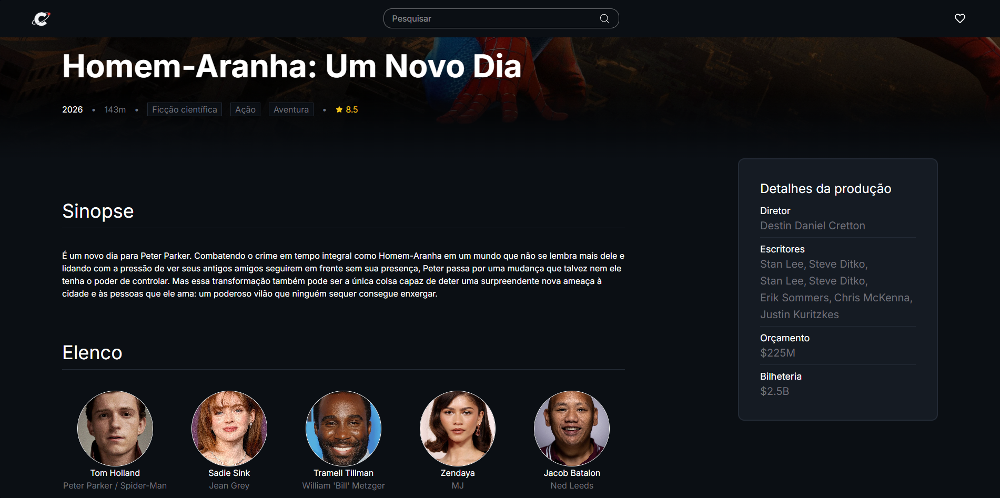
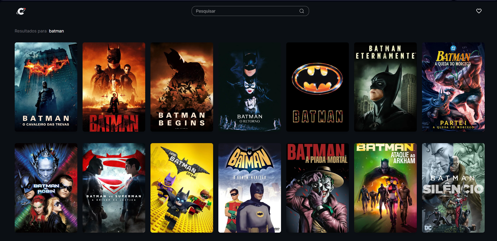

# CineVerse 🎬

Catálogo de filmes para explorar títulos, descobrir lançamentos e salvar seus favoritos.

**React · JavaScript · Tailwind CSS · Vite · TMDB**

[Ver projeto online](https://cine-verse-system.vercel.app)

---

## Preview

| Detalhes do filme | Pesquisa por nome |
|---|---|
|  |  |

## Funcionalidades

- Busca por título e exploração por gênero.
- Carrosséis de populares, tendências, lançamentos e mais bem avaliados.
- Detalhes dos filmes e recomendações.
- Favoritos salvos no navegador.
- Interface responsiva.

## Executar localmente

Consulte o [guia de desenvolvimento](docs/DEVELOPMENT.md).

---

Desenvolvido por **Leonardo Orphali**.

[Portfólio](https://leonardoorphali.github.io/leonardo-orphali/) · [LinkedIn](https://www.linkedin.com/in/leonardo-orphali)

Dados e imagens: [TMDB](https://www.themoviedb.org/).
Este produto utiliza a API do TMDB, mas não é endossado nem certificado pelo TMDB.
Não oferece reprodução de filmes.